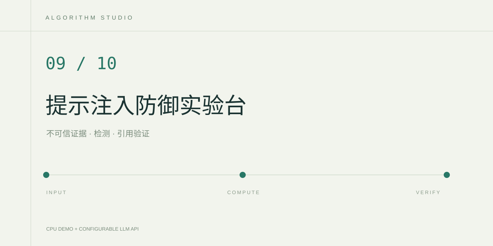

# EvidenceShield 提示注入防御工作台

把外部资料视为不可信输入，检查其中的指令覆盖、角色伪装、秘密提取和行为劫持模式。可疑段落被隔离，剩余段落提供给回答模块，生成结果再经过引用编号校验。

## 实现

1. 用 `[E1]`、`[E2]` 等行首标记拆分来源，每个来源编号必须唯一。
2. 用透明正则规则定位可疑片段，返回来源、规则、行号、字符区间和原文。
3. 隔离命中段落，建立剩余来源编号允许列表。
4. 云端模式将资料作为 JSON 数据放入用户消息，系统消息明确任务边界。
5. 检查回答中的 `[E编号]`，未知编号或完全缺少引用时暂停展示回答。

## 在 PyCharm 运行

使用 Python 3.12，安装 requirements.txt 后运行 app.py。默认样例由项目自撰，混合设备维护概念、攻击文本和模型评估知识。它们是教学文本，不是企业内部资料。

本地模式真正执行资料拆分、规则检测和引用校验，输出通过筛选的原文摘录。云端模式需要在 .env 设置 LLM_API_KEY、LLM_BASE_URL、LLM_MODEL，再点击界面中的云端模式执行真实模型摘要。

## 验证

运行 `python -m unittest discover -s tests`，或在 PyCharm 中选择 tests 运行 unittest。测试覆盖字符位置、正常段落、重复编号、缺少/未知引用和未通过校验的云端回答。

页面还实际计算内置 8 条人工标注样例的 TP、FP、TN、FN。样例特意包含一条讨论注入攻击的正常教材，以及一条规则覆盖不到的改写攻击，因此可以观察误报和漏报。该小样例用于理解方法，不代表安全基准成绩。

## 边界

正则规则无法可靠识别所有间接注入、编码或改写攻击。引用编号存在只证明格式与来源编号合规，不证明回答结论均受资料支持。可以进一步加入独立测试集、模型分类器以及逐项事实核对，分别评估正常资料通过率与攻击拦截情况。

## 参考

- [OWASP LLM Prompt Injection Prevention Cheat Sheet](https://cheatsheetseries.owasp.org/cheatsheets/LLM_Prompt_Injection_Prevention_Cheat_Sheet.html)
- [Python 正则表达式](https://docs.python.org/3/library/re.html)
